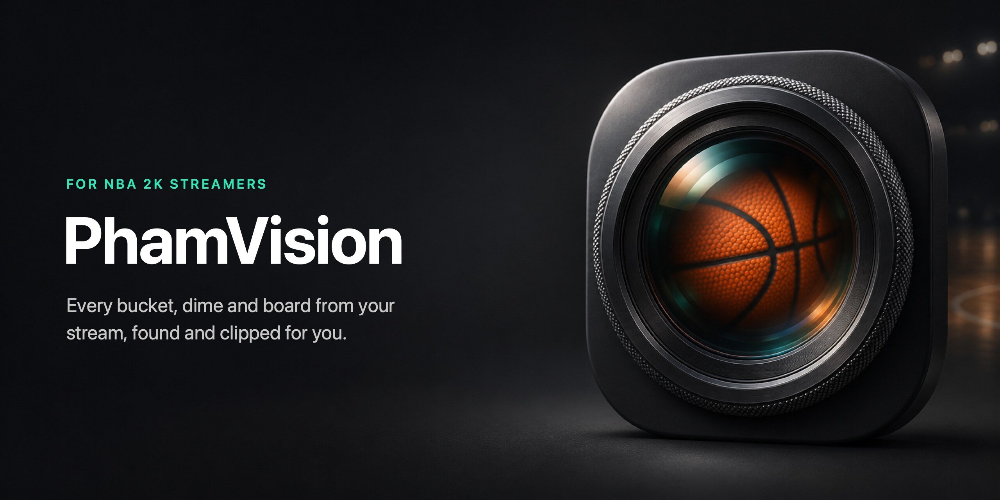
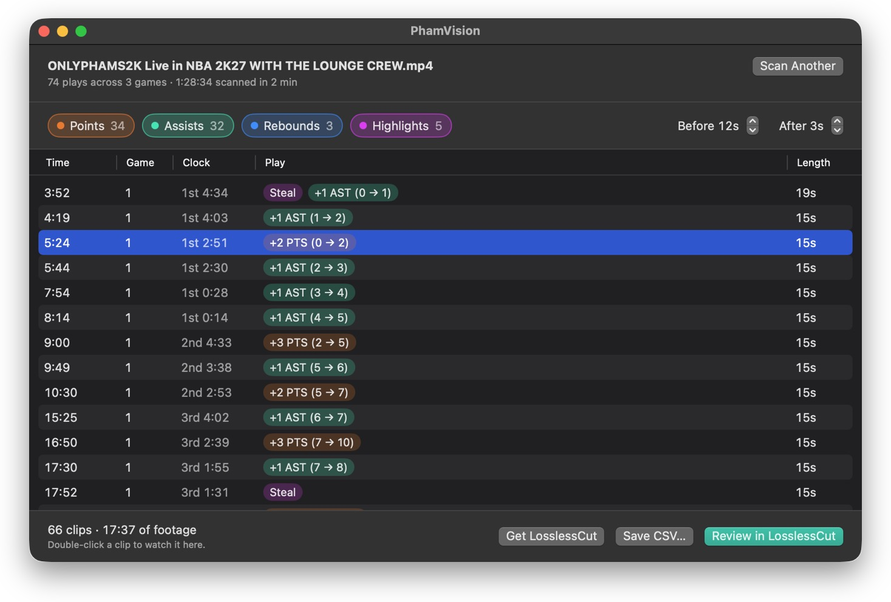

<p align="center">
  
</p>

<h1 align="center">PhamVision</h1>

<p align="center">
  Drop in a 5-hour NBA 2K recording. Get back every play, marked and ready to clip, in minutes.
</p>

<p align="center">
  <a href="https://github.com/mikebuckets171/PhamVision/actions/workflows/ci.yml"></a>
  <a href="https://github.com/mikebuckets171/PhamVision/releases/latest"></a>
  
  
  <a href="LICENSE"></a>
</p>

<p align="center">
  
</p>

---

## Why

Scrubbing through hours of 2K footage to find your best plays is miserable. The trick streamers use is to watch the stat line in the top-right corner: when your assists go from 17 to 18, something worth clipping just happened.

PhamVision does that watching for you. It reads your **PTS, REB and AST** off the HUD for the whole recording, marks every moment one of them goes up, and hands the list to [LosslessCut](https://github.com/mifi/lossless-cut), where you tick the clips you want and export them at full quality.

Tools that clip on loud audio fire on every crowd roar and miss the quiet dimes. PhamVision clips on what actually happened in the game.

## What it does

- **Finds your plays from the stat line.** Every time your points, rebounds or assists tick up, that's a play.
- **Catches steals and blocks** from the event feed under the HUD, since the stat line doesn't count them.
- **Labels everything:** game number, quarter and game clock, and what happened, e.g. `G2 · 3rd 1:22 · Points +3 PTS (22 → 25)`.
- **Watch any clip right in the app.** Double-click a row (or press Space) to play just that clip, then step through the rest with the arrow keys.
- **Clips you can adjust.** 12 seconds before the play and 3 after by default, changeable in the app. Back-to-back plays merge into one clip instead of duplicating footage.
- **Review in LosslessCut.** One click opens the recording with every clip already marked. Clips are cut straight from your original file, so there's no re-encoding and no quality loss.
- **Built for long streams.** Keeps your Mac awake while it scans, shows progress in the Dock, and notifies you when it's done.
- **Runs on your Mac.** Nothing is uploaded anywhere. It works offline.

## Download

1. Download **PhamVision.zip** from the [latest release](https://github.com/mikebuckets171/PhamVision/releases/latest) and unzip it.
2. Move **PhamVision.app** to Applications.
3. Install [LosslessCut](https://github.com/mifi/lossless-cut/releases/latest) (free) for reviewing and exporting clips.

> [!NOTE]
> PhamVision isn't notarised by Apple yet, so the first time you open it macOS will say it can't verify the developer. Open **System Settings → Privacy & Security**, scroll down, and click **Open Anyway** next to the PhamVision message. You only need to do this once.

## How to use it

1. **Record your session** as usual. **MP4, MOV and MKV** all work, so there's no need to convert MKV recordings first.
   For MKV, PhamVision makes a temporary MP4 copy while it scans (no re-encoding, so it's quick and lossless) and deletes it afterwards. It needs LosslessCut installed for this, and free disk space about the size of the recording.
2. **Drop the recording** onto the PhamVision window, or onto its Dock icon.
3. **Wait a few minutes.** On an M5 Pro, an 89-minute recording takes about 2½ minutes. A 5-hour stream takes roughly 10–20 minutes, depending on your Mac.
4. **Check the list.** Filter by points, assists, rebounds or highlights, double-click any clip to watch it, and change how much footage each clip keeps. Your settings are remembered.
5. **Click Review in LosslessCut.** Your recording opens with every clip marked and selected. Untick the ones you don't want, then export.

## How it works

```text
recording.mp4
   │  decoded by the Mac's media engine, 2 frames per second
   ▼
stat line ──► digit matching ──► PTS 18 → 21 at 24:33
event feed ─► text recognition ─► "Steal: +2" at 17:51
scoreboard ─► text recognition ─► 4th 0:57
   │
   ▼
plays ──► clips (12 s before, 3 s after, merged) ──► LosslessCut project
```

- **Reading the numbers.** The HUD draws its numbers in one fixed font on a dark backing, so PhamVision matches each digit's shape against templates of that font instead of using general text recognition. On the sample recording this read every change correctly. Apple's text recognizer, by comparison, regularly read a 6 as a 9 and skipped lone zeros.
- **Ignoring noise.** A change only counts once it's been read on consecutive frames, so a single bad frame never becomes a clip. When 2K hides the HUD for a replay after a basket, the play is placed at the moment the HUD disappeared, which is when the shot went in.
- **Splitting games.** A new game starts when all your stats reset to zero, or when the quarter on the scoreboard goes backwards.
- **Reading the feed and clock.** Free text like "Steal: +2" and "4th 0:57" goes through Apple's on-device text recognition.
- **Reading MKV.** macOS can't open MKV, so PhamVision borrows the ffmpeg that ships inside LosslessCut to copy the video into a temporary MP4, scans that, and still points LosslessCut at your original file.
- **Handing off.** The results are written as `<recording>-proj.llc` next to your video, the project file LosslessCut opens automatically.

### Tested on

Two Rec sessions recorded at 1080p60, checked against the HUD at the end of every game:

| | Session 1 (89 min) | Session 2 (69 min) |
|---|---|---|
| Games found | 3 of 3 | 2 of 2 |
| Stat changes found | every PTS, REB and AST change | every PTS, REB and AST change |
| Steals and blocks from the feed | 6 | 3 |
| Final stats match the HUD | yes | yes |
| Time to scan, M5 Pro | 142 s | 156 s |

The digit templates were built from the first session only, so the second session is unseen footage.

## Supported

| | |
|---|---|
| Game | NBA 2K27, default player HUD position |
| Modes | Tested in The Rec. Other modes that show the same player HUD should work; please [report](https://github.com/mikebuckets171/PhamVision/issues/new/choose) any that don't |
| Resolutions | 720p to 4K, any 16:9. Tested on a native 1080p recording, plus the same footage rescaled to 720p, 1440p and 4K, which found identical plays |
| Files | MP4, MOV, M4V directly. MKV, FLV and TS through a temporary copy, which needs LosslessCut (or Homebrew ffmpeg) installed. Video must be H.264 or HEVC |
| Macs | macOS 14 Sonoma or later, Apple Silicon or Intel |

## Command line

PhamVision also comes as a command-line tool, `pv`, for batch jobs or scripting:

```bash
swift build -c release
.build/release/pv clips ~/Movies/stream.mp4 --before 12 --after 3 --csv 1
```

`pv clips` scans a recording, prints the clips, and writes the LosslessCut project and a CSV next to it. Run `.build/release/pv` with no arguments to see the other commands.

## Building from source

Requires Xcode 16 or later.

```bash
git clone https://github.com/mikebuckets171/PhamVision.git
cd PhamVision
swift test
scripts/package.sh 0.1.0
open dist/PhamVision.app
```

`scripts/package.sh` builds a universal app (Apple Silicon and Intel) into `dist/`.

### Project layout

| Path | What's there |
|---|---|
| `Sources/PhamVisionCore/VideoSampler.swift` | Decodes the recording in order and hands out frames |
| `Sources/PhamVisionCore/DigitReader.swift` | Splits a stat cell into digits and matches them against the font |
| `Sources/PhamVisionCore/HUDReader.swift` | Finds the stat line and event feed in a frame |
| `Sources/PhamVisionCore/VideoScanner.swift` | Reads the whole recording in parallel chunks |
| `Sources/PhamVisionCore/PlayDetector.swift` | Turns readings into plays and games |
| `Sources/PhamVisionCore/Clips.swift` | Builds and merges clip windows |
| `Sources/PhamVisionCore/LosslessCut.swift` | Writes the LosslessCut project and CSV |
| `Sources/PhamVision/` | The Mac app |
| `Sources/pv/` | The command-line tool |

If 2K changes its HUD font in a future game, regenerate the digit templates from a few frames you've checked by eye:

```bash
.build/release/pv templates recording.mp4 --labels "300:0,0,2;1500:21,0,14;4880:30,1,6" > Sources/PhamVisionCore/DigitTemplates.swift
```

Each label is `seconds:PTS,REB,AST`. Between them, the frames need to cover every digit from 0 to 9.

## Roadmap

- Ranking clips, so dunks and game-winners float to the top
- Teammate highlights (assists you threw, buckets you set up)
- Notarised builds

## Credits

- [LosslessCut](https://github.com/mifi/lossless-cut) by Mikael Finstad does the reviewing and lossless export.
- Built for and named after **onlyphams**, who came up with the stat-line trick.

## Disclaimer

PhamVision is an independent fan-made tool. It isn't affiliated with or endorsed by 2K, Take-Two Interactive, Visual Concepts or the NBA. NBA 2K is a trademark of its owners. PhamVision only reads video files on your own computer and never connects to any game or online service.

## Licence

[MIT](LICENSE)
